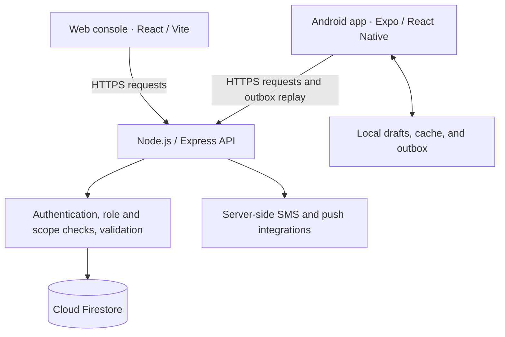

# HUGPONG

### Agricultural Management Platform

Field operations, farm supervision, and Sugar Regulatory Administration (SRA) reporting for sugarcane block farms in Silay City, Philippines.

[](https://github.com/anautumny/HUGPONG/actions/workflows/verify.yml)
[](https://github.com/anautumny/HUGPONG/releases/tag/Beta-1.0.8)

**[Open Web Console](https://hugpong-beta.onrender.com)** · **[Download Android APK](https://hugpong-beta.onrender.com/downloads/android/1.0.8)** · **[Release Notes](docs/RELEASE_1.0.8.md)** · **[User Manual](docs/USER_MANUAL.md)**

## Overview

HUGPONG connects Farm Members, Farm Managers, SRA Admins, and Super Admins through a shared agricultural record. Members plan and record work, managers supervise fields and compile monthly audits, and SRA reviewers certify reports and publish price references.

The Android application supports selected field workflows without connectivity. The Web Management Console requires an internet connection. Both use the same authoritative API and database, so shared records follow the same validation and access rules.

## Current release

| Item | Details |
| --- | --- |
| Version | **Beta 1.0.8** |
| Release date | October 28, 2026 |
| Distribution | Hosted Web console and signed Android APK |
| Android package | `com.hugpong.app` |
| Android version code | `10` |
| Release artifacts | [GitHub release](https://github.com/anautumny/HUGPONG/releases/tag/Beta-1.0.8) |

This beta includes the finalized UI/UX updates, improved mobile typography and layouts, paginated activity rankings, corrected farm and report labels, stronger session handling, and offline queue preservation during cache upgrades. See the [release notes](docs/RELEASE_1.0.8.md) for verification results and remaining acceptance checks.

To update Android, install the signed APK over the existing application. Synchronize pending work first; uninstalling the application or clearing its data can remove local drafts and unsynchronized entries. Test credentials are supplied privately by the beta coordinator.

## Core capabilities

| Area | What HUGPONG provides |
| --- | --- |
| Farm and field registry | Block-farm assignments, field ownership, plot area, and crop-cycle relationships |
| Planning and operations | Scheduled work, drafts, standard and permitted custom activities, actual costs, and operation history |
| Crop-cycle tracking | Six stages: Land Preparation, Planting, Basal, Weeding, Top-Dress, and Harvest |
| Mobile synchronization | Local drafts, cached records, and a durable account-scoped outbox for supported offline work |
| Monthly audits | Manager compilation, SRA review and certification, report history, and QR-reference verification |
| Analytics | Recorded activity frequency, costs, field comparisons, and SRA market-price summaries |
| Administration | Role-based account controls, support tickets, audit events, diagnostics, and encrypted business-data recovery |

Analytics help users identify recorded activity patterns and compare costs. They describe the available records; they do not prove field work occurred or guarantee yield or profit. The [System Guide](docs/SYSTEM_GUIDE.md) explains the calculations, examples, and interpretation limits.

## Roles and platform support

| Role | Web | Android | Primary responsibility |
| --- | :---: | :---: | --- |
| Farm Member | — | Yes | Plan and record work on assigned fields |
| Farm Manager | Yes | Yes | Supervise the assigned farm, manage fields and members, and compile audits |
| SRA Admin | Yes | Yes | Review and certify audits, oversee farms, and publish price references |
| Super Admin | Yes | — | Manage platform administration, support, diagnostics, and backup/recovery |

Available actions depend on the account's role, status, and assignments. Manager Takeover requires online authorization and preserves the field owner's identity. SRA certification applies to an audit report.

## Architecture



- **Database:** Firestore stores canonical shared records. Client write rules deny direct canonical mutations.
- **Server/API:** Express centralizes authentication, permissions, validation, transactions, and business-data mutations. Web uses an HttpOnly session cookie; Mobile authenticates API requests with server-issued credentials.
- **Web:** React, Vite, and Tailwind CSS provide the online management console. The Express service serves the production Web build and API together.
- **Mobile:** Expo and React Native provide the Android application. AsyncStorage and the durable outbox retain supported local work until the API accepts it.

An offline entry remains provisional until server acceptance. Reconnection triggers readiness checks and synchronization; rejected or conflicting entries require review. Account administration, takeover authorization, and official report compilation require a live server connection. See [offline workflows](docs/USER_MANUAL.md#12-offline-work-and-synchronization).

## Documentation

| Document | Purpose | PDF |
| --- | --- | --- |
| [User Manual](docs/USER_MANUAL.md) | Role-based instructions for Web and Android | [Download](output/pdf/HUGPONG_User_Manual.pdf) |
| [System Guide](docs/SYSTEM_GUIDE.md) | Backend and data flow, analytics examples, beta checklist, and 38 questions with answers | [Download](output/pdf/HUGPONG_System_Guide.pdf) |
| [Beta 1.0.8 release notes](docs/RELEASE_1.0.8.md) | Release scope, artifact identity, and verification evidence | — |
| [Connectivity and deployment](docs/MOBILE_API_CONNECTIVITY_AND_DEPLOYMENT.md) | API origins, environment configuration, hosting, and device checks | — |
| [Backup and recovery](docs/BACKUP_AND_RECOVERY_RUNBOOK.md) | Encrypted archives, recovery drills, and recovery limits | — |
| [Continuous verification](docs/PHASE_6_DEPLOYMENT_AUTOMATION.md) | Deployment parity and the automated release gate | — |
| [Hosting reliability](docs/HOSTING_RELIABILITY_AND_CAPACITY.md) | Readiness, graceful shutdown, and host measurement | — |
| [Staging capacity checks](docs/STAGING_APPLICATION_CAPACITY.md) | Guarded application and duplicate-write checks before expansion | — |

## Local development

### Prerequisites

- **Node.js 24.22.1 or a newer patched Node 24 release below 25**, with npm. The baseline is recorded in [`.node-version`](.node-version) and package engines.
- A separate development Firebase project with Firestore, matching Web/Mobile client configuration, and authorized server credentials.
- An Android device or emulator for Mobile development. Signed beta builds are available through the release links above.

### 1. Clone and install

```sh
git clone https://github.com/anautumny/HUGPONG.git
cd HUGPONG
npm --prefix server ci
npm --prefix web/react-app ci
npm --prefix mobile ci
```

### 2. Configure the environment

Copy these templates to the corresponding ignored `.env` files, then replace their placeholders:

| Template | Local destination | Configuration |
| --- | --- | --- |
| [`server/.env.example`](server/.env.example) | `server/.env` | Firebase Admin identity, session secret, allowed origins, and server integrations |
| [`web/react-app/.env.example`](web/react-app/.env.example) | `web/react-app/.env` | Matching `VITE_FIREBASE_*` client configuration |
| [`mobile/.env.example`](mobile/.env.example) | `mobile/.env` | Explicit `EXPO_PUBLIC_API_BASE_URL` and matching `EXPO_PUBLIC_FIREBASE_*` values |

All three applications must target the same intended Firebase project. For Mobile development, set one API origin reachable from the device; a physical phone cannot reach your computer through the phone's `localhost`. The application does not probe alternate API hosts. Production Mobile builds require HTTPS.

Keep service-account files, session secrets, SMS tokens, signing keys, and backup passphrases outside source control. Only public client configuration belongs in `VITE_*` or `EXPO_PUBLIC_*` variables. Use the [deployment guide](docs/MOBILE_API_CONNECTIVITY_AND_DEPLOYMENT.md) for the complete environment contract.

### 3. Start the Web console and API

Build the Web client and start the combined service from the repository root:

```sh
npm --prefix web/react-app run build
npm start
```

Open **http://localhost:3000**. Rebuild the Web client after source changes when using this mode.

For Web hot reload, keep the API running and use `npm --prefix web/react-app run dev` in another terminal. Vite runs on port `5173` and proxies API requests to port `3000`; add `http://localhost:5173` to the server's development `CORS_ORIGINS` before starting the API.

### 4. Start Mobile development

```sh
npm --prefix mobile start
```

Follow the Expo development instructions for your device or emulator. Restart Metro after changing development environment values. Installed release builds require a new build when embedded configuration changes.

Account bootstrap and demonstration-data commands are explicit, operator-gated procedures. See [NACAYAO beta-data maintenance](docs/NACAYAO_BETA_DATA.md) for the removable sample batch; normal startup does not reset data or create test accounts.

## Verification and deployment

With dependencies installed and the release environment configured, run:

```sh
npm run verify:release
```

The release gate checks deployment configuration parity, tracked secret exposure, server authority, client identifiers, the existing Mobile dependency mitigation, Server and Web tests, the Web production build, and an Android Expo export. [GitHub Actions](https://github.com/anautumny/HUGPONG/actions/workflows/verify.yml) runs the same gate for pushes and pull requests.

The live database integrity audit is a separate read-only operator command:

```sh
npm --prefix server run audit:legacy-data
```

Production uses the combined Express/Web service and a separately signed Android build. Deploy with the exact HTTPS origin, production secrets, and matching Firebase project configuration. Use `/health/ready` for readiness and `/health/live` for process liveness. Publish and verify the signed APK before updating the Web download manifest.

Automated export checks do not replace installed-device acceptance. Before broadening the beta, verify Android upgrade behavior, role-based workflows, airplane-mode persistence, reconnection without duplicate records, and report results on actual devices. Release-specific limitations, including the open Expo CLI/Zod tooling advisory, are recorded in the [release notes](docs/RELEASE_1.0.8.md).

Operators must download an encrypted business-data backup every 24 hours, retain two separate copies, and validate a recovery drill at least every 30 days. These archives do not include every authentication record or a phone's unsynchronized queue; follow the [recovery runbook](docs/BACKUP_AND_RECOVERY_RUNBOOK.md).

## Repository layout

```text
HUGPONG/
├── server/                 Express API, domain logic, schema, scripts, and tests
├── web/react-app/          React management console and Web tests
├── mobile/                 Expo / React Native Android application
├── docs/                   User, system, release, and operations documentation
├── output/pdf/             Published PDF guides
├── .github/workflows/      Continuous release verification
├── firestore.rules         Client access rules
└── firestore.indexes.json  Firestore index definitions
```

## Support and issue reporting

Use the application's support-ticket workflow for account and operational issues. For a reproducible software bug, [open a GitHub issue](https://github.com/anautumny/HUGPONG/issues) with the app version, platform, affected role, connection state, steps to reproduce, and expected versus actual behavior. Remove personal information from screenshots and logs. Send credentials or security-sensitive details privately to the project maintainer.
